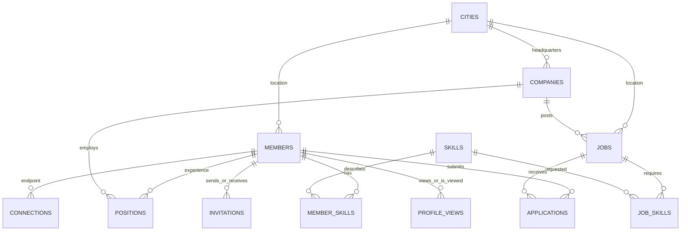

# Phase 2: Schema Design and Seed Data Checks

## Design summary

We built the tables from the 12 CSV files and kept their names and column names as provided, so the supplied queries can use them as written. We chose the types based on the values we found: flags use `boolean`, work-history dates use `date`, event times with an India offset use `timestamptz`, and salaries use `numeric(6,2)`. This first schema file contains the rules needed to keep the rows consistent. We have left performance indexes for the optimization phase; PostgreSQL still creates its usual indexes for primary keys and unique constraints.

## Data dictionary

In the table below, `PK` means primary key, `FK` means foreign key, `UQ` means unique, `NN` means the value is required, and `CK` means a check constraint. We have included the delete rule alongside foreign keys because it affects what happens if a referenced row is removed.

| Table | Column | Type and constraints | Why |
|---|---|---|---|
| `cities` | `city_id` | integer, PK | Stable city identifier. |
| | `city_name` | text, NN; part of UQ (`city_name`, `state`) | City labels can recur in different states, so the natural name key includes state. |
| | `state` | text, NN; part of UQ (`city_name`, `state`) | Disambiguates city labels and supports location grouping. |
| `companies` | `company_id` | integer, PK | Stable company identifier. |
| | `company_name` | text, NN | Display name; not made unique because names need not be globally unique in a general company directory. |
| | `industry` | text, NN | Industry label used by employer reports. |
| | `company_size` | text, NN, CK allowed size bands | A short categorical value, so keep its source label and reject unknown bands. |
| | `hq_city_id` | integer, FK → `cities.city_id`, `ON DELETE SET NULL` | Headquarters location is optional; removing a city should not delete a company. |
| | `founded_year` | smallint, nullable, CK 1800–2100 | A year is a small whole number; nullable if unknown. |
| | `website` | text, nullable | 400 companies have no website in the export. |
| `skills` | `skill_id` | integer, PK | Stable skill identifier. |
| | `skill_name` | text, NN, UQ | Skill name is the natural label and is unique in this export. |
| `members` | `member_id` | integer, PK | Stable member identifier. |
| | `first_name` | text, NN | Names vary in length; text avoids arbitrary length limits. |
| | `last_name` | text, NN | Names vary in length; text avoids arbitrary length limits. |
| | `headline` | text, nullable | 5,946 profiles have no headline. |
| | `email` | text, NN, UQ | Sign-in identifier; all values are unique even when compared case-insensitively in this export. |
| | `city_id` | integer, FK → `cities.city_id`, `ON DELETE SET NULL` | Member location is optional; a missing city should not delete the member. |
| | `industry` | text, NN | Member's industry label. |
| | `is_premium` | boolean, NN | Source `t`/`f` values represent a yes/no flag. |
| | `open_to_work` | boolean, NN | Source `t`/`f` values represent a yes/no flag. |
| | `created_at` | timestamptz, NN | Creation instant; source values include `+05:30`. |
| `positions` | `position_id` | integer, PK | Stable work-history row identifier. |
| | `member_id` | integer, NN, FK → `members.member_id`, `ON DELETE CASCADE` | A position belongs to a member; remove it with its profile. |
| | `company_id` | integer, NN, FK → `companies.company_id`, `ON DELETE RESTRICT` | Preserve work history rather than silently deleting it with a company. |
| | `title` | text, NN | Role title. |
| | `employment_type` | text, NN, CK: `FULL_TIME`, `CONTRACT`, `INTERNSHIP` | Accept the source's three employment categories. |
| | `start_date` | date, NN | A calendar date, not an instant. |
| | `end_date` | date, nullable, CK `end_date >= start_date` | NULL marks a current position; otherwise end cannot precede start. |
| `member_skills` | `member_id` | integer, NN, FK → `members.member_id`, `ON DELETE CASCADE`; part of PK | Skill association belongs to the member. |
| | `skill_id` | integer, NN, FK → `skills.skill_id`, `ON DELETE CASCADE`; part of PK | Skill association belongs to the skill. |
| | `endorsements` | integer, NN, CK `>= 0` | Whole-number endorsement count cannot be negative. |
| `connections` | `member_a` | integer, NN, FK → `members.member_id`, `ON DELETE CASCADE`; part of PK | One endpoint; deleting a member removes their connection rows. |
| | `member_b` | integer, NN, FK → `members.member_id`, `ON DELETE CASCADE`; part of PK | Other endpoint; composite key prevents duplicate pairs. |
| | `connected_at` | timestamptz, NN | Connection creation instant. |
| | *(table rule)* | PK (`member_a`, `member_b`), CK `member_a < member_b` | Stores an undirected pair once and disallows self-connections. |
| `invitations` | `invitation_id` | integer, PK | Stable invitation identifier. |
| | `sender_id` | integer, NN, FK → `members.member_id`, `ON DELETE CASCADE` | Invitation sender. |
| | `recipient_id` | integer, NN, FK → `members.member_id`, `ON DELETE CASCADE` | Invitation recipient. |
| | `note` | text, nullable | 45,168 invitations have no note. |
| | `sent_at` | timestamptz, NN | Sending instant. |
| | `status` | text, NN, CK: `PENDING`, `ACCEPTED`, `IGNORED`, `WITHDRAWN` | Restricts the invitation lifecycle to observed states. |
| | `responded_at` | timestamptz, nullable, CK paired with status | Pending invitations have no response time; every non-pending row has one in this export. |
| | *(table rule)* | CK `sender_id <> recipient_id` | A member cannot invite themself. |
| `jobs` | `job_id` | integer, PK | Stable job identifier. |
| | `company_id` | integer, NN, FK → `companies.company_id`, `ON DELETE RESTRICT` | Keep the employer while jobs or applications reference it. |
| | `title` | text, NN | Job title; free text for search. |
| | `city_id` | integer, nullable, FK → `cities.city_id`, `ON DELETE RESTRICT` | NULL only for remote jobs in the export; restrict city deletion to preserve that rule. |
| | `workplace_type` | text, NN, CK: `ONSITE`, `HYBRID`, `REMOTE` | Restricts workplace categories. |
| | `employment_type` | text, NN, CK: `FULL_TIME`, `CONTRACT`, `INTERNSHIP` | Restricts employment categories. |
| | `min_experience` | smallint, NN, CK `>= 0` | Small whole number of required experience years. |
| | `min_salary_lpa` | numeric(6,2), nullable, CK `>= 0` | Salary amount in lakh-per-annum units; preserve decimal values. |
| | `max_salary_lpa` | numeric(6,2), nullable, CK `>= 0` | Optional salary ceiling. |
| | `posted_at` | timestamptz, NN | Posting instant. |
| | `closes_at` | timestamptz, NN | Closing instant. |
| | `status` | text, NN, CK: `OPEN`, `CLOSED` | Job availability state. |
| | *(table rules)* | CK max ≥ min when both known; remote iff city is NULL; close ≥ post | Enforces coherent salary, location, and posting-window values. |
| `job_skills` | `job_id` | integer, NN, FK → `jobs.job_id`, `ON DELETE CASCADE`; part of PK | Required-skill association belongs to its job. |
| | `skill_id` | integer, NN, FK → `skills.skill_id`, `ON DELETE CASCADE`; part of PK | Required-skill association belongs to its skill. |
| `applications` | `application_id` | integer, PK | Stable application identifier used by the workload. |
| | `job_id` | integer, NN, FK → `jobs.job_id`, `ON DELETE RESTRICT` | Prevent deleting a job while application history references it. |
| | `member_id` | integer, NN, FK → `members.member_id`, `ON DELETE RESTRICT` | Prevent deleting a member while application history references them. |
| | `applied_at` | timestamptz, NN | Application instant. |
| | `easy_apply` | boolean, NN | Source `t`/`f` flag. |
| | `status` | text, NN, CK: `APPLIED`, `VIEWED`, `SHORTLISTED`, `INTERVIEW`, `OFFER`, `HIRED`, `REJECTED`, `WITHDRAWN` | Restricts application pipeline values. |
| | `status_updated_at` | timestamptz, NN, CK `>= applied_at` | Latest status time cannot precede the application. |
| | *(table rule)* | UQ (`job_id`, `member_id`) | One application per member per job; the export has no duplicates. |
| `profile_views` | `view_id` | integer, PK | Stable view-event identifier. |
| | `viewer_id` | integer, nullable, FK → `members.member_id`, `ON DELETE SET NULL` | NULL is used for private-mode views; deleting a viewer anonymizes past events. |
| | `viewed_id` | integer, NN, FK → `members.member_id`, `ON DELETE CASCADE` | Profile that received the view. |
| | `viewed_at` | timestamptz, NN | View-event instant. |
| | *(table rule)* | CK viewer is NULL or differs from viewed member | Disallows self-views while allowing private-mode rows. |

We used primary keys on all 12 tables, composite keys on the link tables, and foreign keys wherever one row refers to another. We also added checks for the allowed status values, valid dates and salary ranges, and the rules for connections and remote jobs. Along with the required and unique fields, this gives us more than 12 constraints that protect the data. We did not add any manual indexes in Phase 2; PostgreSQL creates indexes for the primary and unique keys itself.

## Relationship diagram

The same relationships are shown as a Mermaid ER diagram and as `diagrams/er_diagram.png`.



We use `member_skills` and `job_skills` to connect members and skills, and jobs and skills, since both are many-to-many relationships. `connections` links members to other members; storing the smaller ID first lets us keep each pair only once. An invitation has a sender and a recipient, while a profile view has a viewer and the member whose profile was viewed.

## Functional dependencies and normal forms

For each table, we list the key that determines the rest of the row. Where we added a unique key, it is listed as another determinant. Based on these dependencies, none of the tables has a non-key column determining another non-key column, so the tables meet BCNF under the keys shown.

| Table | Functional dependencies | Normal form |
|---|---|---|
| `cities` | `city_id → city_name, state`; (`city_name`, `state`) → `city_id` (UQ) | BCNF: both determinants are candidate keys. |
| `companies` | `company_id → company_name, industry, company_size, hq_city_id, founded_year, website` | BCNF under the declared key; company names intentionally are not assumed unique. |
| `skills` | `skill_id → skill_name`; `skill_name → skill_id` (UQ) | BCNF: both determinants are candidate keys. |
| `members` | `member_id → all other columns`; `email → member_id` (UQ) | BCNF: declared determinants are candidate keys. |
| `positions` | `position_id → member_id, company_id, title, employment_type, start_date, end_date` | BCNF: the identifier determines the position facts. |
| `member_skills` | (`member_id`, `skill_id`) → `endorsements` | BCNF: the full pair is the key; neither endpoint alone determines the count. |
| `connections` | (`member_a`, `member_b`) → `connected_at` | BCNF: the unordered relationship is represented as its ordered pair key. |
| `invitations` | `invitation_id → sender_id, recipient_id, note, sent_at, status, responded_at` | BCNF: invitation identifier determines event facts. |
| `jobs` | `job_id → company_id, title, city_id, workplace_type, employment_type, min_experience, min_salary_lpa, max_salary_lpa, posted_at, closes_at, status` | BCNF: job identifier determines posting facts. |
| `job_skills` | (`job_id`, `skill_id`) → no additional non-key attributes | BCNF: composite key represents the association. |
| `applications` | `application_id → job_id, member_id, applied_at, easy_apply, status, status_updated_at`; (`job_id`, `member_id`) → application facts (UQ) | BCNF: both declared determinants are candidate keys. |
| `profile_views` | `view_id → viewer_id, viewed_id, viewed_at` | BCNF: event identifier determines event facts. |

We kept the main records separate from their link tables. This avoids storing a list of skills or connections inside one row and avoids partial dependencies in the link tables. A member's `headline` might mention the same role or company as their current position, but it is free text and may say something different, so we kept it. We can work out a member's current company from the position with no `end_date`, so we did not add another current-company field to `members`.

## Seed-data nulls and observed data issues

Some blank fields in the export have a clear meaning, so we left them nullable instead of filling in made-up values. We found 5,946 members with no `headline`, 1,231 with no city, 400 companies with no website, and 34,238 positions with no end date (their current jobs). There are 45,168 invitations with no note and 3,098 pending invitations with no response time. All 2,217 jobs without a city are remote jobs. Profile views with no `viewer_id` are private-mode views (50,173 rows). Salary bounds can be missing independently, so we only compare them when both are present. `founded_year` and `min_experience` are filled in for every row in this export.

We also checked two rules that sound reasonable but do not match this export, so we did not put them in the schema:

- **Accepted invitation ↔ connection:** 36,157 of 36,169 accepted invitations have no matching connection row. The current export may omit connections that were removed later, or contain incomplete history. An accepted invitation therefore cannot be required to have a current connection.
- **Application before job close:** 14,574 applications have an `applied_at` timestamp later than their job's `closes_at` timestamp. This may reflect late applications, changed dates, or export inconsistency. We preserve the rows and do not add a cross-table timing constraint.

We left the CSV rows as they were. These counts are notes about the supplied snapshot, not corrections to it.

## Load verification and integrity checks

These are the row counts we expected from the brief and confirmed against the CSV files:

| Table | Expected rows |
|---|---:|
| cities | 10 |
| members | 40,000 |
| companies | 2,000 |
| positions | 99,940 |
| skills | 72 |
| member_skills | 212,417 |
| connections | 219,966 |
| invitations | 60,000 |
| jobs | 15,000 |
| job_skills | 65,719 |
| applications | 149,984 |
| profile_views | 199,996 |

Before loading, we checked the references and keys in the CSVs. There were no orphaned references, duplicate keys or case-insensitive duplicate emails. Connection pairs were ordered and had no self-links; remote jobs had no city; invitation response times matched their statuses; and position dates were in order. We also checked that no member had more than one current position. After loading, these SQL checks make some of those checks easy to repeat; a zero means we found no violations.

```sql
-- We checked that each connection is stored once, with the smaller member ID first.
SELECT count(*) AS violations FROM linkedin.connections WHERE member_a >= member_b;

-- We checked that a member does not have two positions marked as current.
SELECT count(*) AS members_with_multiple_current_positions
FROM (SELECT member_id FROM linkedin.positions WHERE end_date IS NULL
      GROUP BY member_id HAVING count(*) > 1) AS current_roles;

-- We checked that pending invitations have no response time and answered ones do.
SELECT count(*) AS violations FROM linkedin.invitations
WHERE (status = 'PENDING') <> (responded_at IS NULL);

-- We checked that each job-skill row points to a real job and a real skill.
SELECT count(*) AS orphaned_job_skills
FROM linkedin.job_skills js
LEFT JOIN linkedin.jobs j ON j.job_id = js.job_id
LEFT JOIN linkedin.skills s ON s.skill_id = js.skill_id
WHERE j.job_id IS NULL OR s.skill_id IS NULL;
```

We ran both SQL files in a temporary PostgreSQL 18 database. All 12 imports completed, `ANALYZE` ran, and every table had the expected number of rows. Each of the four SQL checks returned zero violations. We also found no overlapping neighboring position ranges, reversed position dates, or members with more than one current position. The accepted-invitation and late-application findings above are the exceptions we found in the snapshot.

## Running Phase 2

After unzipping `seed_data.zip`, we created an empty database and ran these commands from the project folder:

```sh
psql -d <database> -f sql/01_schema.sql
psql -d <database> -f sql/02_load_data.sql
```

The CSV folder is already in `.gitignore`, so it will not be included in our commits.
